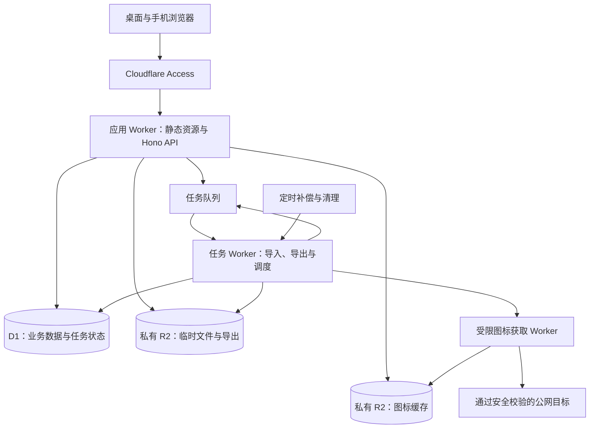

# LuyPage 技术架构

版本：v0.1  
日期：2026-10-15  
状态：实施方案基线；尚未开发或完成运行验证  
产品依据：[网页收藏夹 PRD](PRD.md)

## 1. 决策与边界

### 1.1 已明确的方向

| 决策 | 结论 |
| --- | --- |
| 使用范围 | 本人使用，收藏私有；首版不开放注册、公开导航或团队协作 |
| 数据保存 | 服务端持久化，登录后跨设备访问 |
| 核心交互 | 图标卡片、规则网格、拖拽整理、保存与取消布局草稿 |
| 部署方向 | 采用 Cloudflare 托管方案 |
| R2 | 保留；用户预计 2026 年 12 月具备使用条件，届时接入真实资源 |

R2 的接入时间是开发安排的前提，不是平台开通保证或项目发布日期。当前没有创建或核验任何云资源。首版功能范围仍以 PRD 的 P0 和 A01–A20 为准。

### 1.2 技术方案基线

- 前端：React、TypeScript、Vite、CSS Grid、dnd-kit、TanStack Query。
- 服务端：Cloudflare Workers、Hono，同域 HTTP JSON API。
- 业务数据：D1；Drizzle 管理类型化查询与数据库迁移。
- 文件：私有 R2，保存图标缓存、短期导入分片和生成完成的导出文件。
- 后台任务：Cloudflare Queues；D1 保存任务状态、幂等记录和待投递事件。
- 认证：Cloudflare Access；具体身份提供方、允许名单和会话期限在接入时确定。
- 工程：pnpm，严格 TypeScript，Vitest、Workers 运行时集成测试和 Playwright。

这些选型是本文的实施建议，不表示已经验证版本兼容性、免费额度、性能或账号资源可用性。开始开发时选择相互兼容的稳定版本并提交锁文件。

架构围绕一个仓库和一套业务模型组织。首版不引入实时协作、离线写入、微服务编排、独立搜索引擎、KV 业务数据副本或 Durable Objects。若验证发现 D1 无法满足布局事务，再记录替代方案及其迁移成本，不同时维护两套主存储。

## 2. 系统结构与职责



| 边界 | 职责 |
| --- | --- |
| 浏览器 | 页面呈现、表单、布局草稿、导入预览、上传进度；不持有 Cloudflare 管理凭据 |
| 应用 Worker | 验证身份、校验输入、查询与写入业务数据、接收分片、授权下载、创建任务 |
| 任务 Worker | 分阶段验证和执行导入、构建一致性导出、投递补偿、任务重试与清理 |
| 图标获取 Worker | 按受限策略访问站点并写入图标桶；不绑定 D1、导入桶或私网网络 |
| D1 | 收藏、布局及任务结果的事实来源；R2 文件不能单独代表业务操作成功 |
| R2 | 对象内容；对象键由服务端生成，浏览器经鉴权 API 访问 |
| Queues | 唤醒工作和传递任务标识；任务是否完成以 D1 状态为准 |

网站文件使用 Workers Static Assets，`/api/*` 明确进入 Worker；未知 API 返回 JSON 错误，不落入 SPA 的 HTML 回退。该部署路径由 [Cloudflare React 与 Vite 文档](https://developers.cloudflare.com/workers/framework-guides/web-apps/react/)支持。[Hono](https://hono.dev/docs/getting-started/cloudflare-workers)负责路由和中间件。

后台模块共用领域代码。拆出图标 Worker 的原因是限制不可信外部内容接触业务数据的权限，不是把每个功能部署成服务。

## 3. 代码组织与依赖方向

建议使用一个 pnpm workspace，以下为计划目录，尚未创建：

```text
apps/
  web/                  # React 页面、交互、布局草稿
  api/                  # Hono 路由、认证、静态资源部署入口
  jobs/                 # Queue / Scheduled 入口与任务调度
  icon-fetcher/         # 无公开入口的受限网络获取
packages/
  contracts/            # API schema、错误码、URL 规则、迁移文件格式
  domain/               # 收藏、分组、布局、导入等业务规则
  persistence/          # D1 表定义、事务封装、迁移
  storage/              # R2 对象命名、读写和清理
docs/
  PRD.md
  ARCHITECTURE.md
```

路由和任务入口调用业务模块，业务模块通过明确的持久化接口执行操作。前端只依赖公开契约，不能直接导入数据库模型或 Workers 绑定。数据库行与 API DTO 分开，避免返回身份关联、内部任务信息等字段。

共享 schema 做运行时校验，TypeScript 类型不能替代服务端校验。接口遵循 REST 风格，前端可使用类型化客户端；不额外引入 GraphQL 或自定义 RPC 协议。

## 4. 认证、授权与会话

1. Access 保护应用域名，允许名单仅包含本人；邮箱验证码是可选接入方式，不开放任意邮箱注册。
2. API 验证 `Cf-Access-Jwt-Assertion` 的签名、签发方、受众和有效期，通过验证后建立请求身份。不能信任客户端提供的邮箱或 `userId`。
3. 内部用户使用独立 ID，认证关联记录提供方、签发方和 subject。身份提供方变更需要显式关联，不按任意传入邮箱自动合并账号。
4. 自定义域名、`workers.dev` 和预览入口分别检查访问保护；无用途的公网入口关闭。生产请求缺少有效身份时拒绝处理。
5. 每个查询和写入都限定 `owner_id`；批量 ID、任务 ID、文件 ID 和下载请求采用相同规则。对非本人对象不暴露存在性。
6. 写操作使用非 GET 方法，校验同源 `Origin`，采用 JSON 契约及 CSRF 防护；不向任意源开放带凭据 CORS。

当前官方文档指出，Static Assets 的内部路由不会把 `ctx.access` 传给用户 Worker。因此本架构采用显式 JWT 验证，不把 `ctx.access` 当作唯一身份来源。参见 [Workers Access 集成](https://developers.cloudflare.com/workers/configuration/cloudflare-access/)和[邮箱验证码登录](https://developers.cloudflare.com/cloudflare-one/integrations/identity-providers/one-time-pin/)。

API 正常返回结构化认证错误；Access 在边缘拦截时也可能出现重定向或 HTML 登录响应，客户端必须识别，不能统一显示为 JSON 解析失败。重新认证通过独立页面或窗口完成，原页面保留内存中的表单与布局草稿；回来后重新核验身份和版本再提交。关闭浏览器后的草稿恢复不在首版承诺内。

退出时清空 Query 缓存、选择状态、表单和私有数据，再执行 Access 注销流程。认证恢复成不同用户时丢弃前一身份的数据。默认不将完整收藏缓存到 localStorage、IndexedDB 或 Service Worker。

## 5. 前端状态与交互

| 状态 | 存放位置 | 规则 |
| --- | --- | --- |
| 已保存收藏、分组、标签、任务 | TanStack Query | 按用户身份隔离缓存，API 返回是保存成功依据 |
| 搜索词、分组、标签、排序 | URL 查询参数 | 刷新与返回可恢复；解析时验证参数 |
| 收藏编辑输入 | 表单本地状态 | 保存失败和认证过期不清空 |
| 布局草稿 | 独立 reducer / 状态模块 | 保存前不回写服务器缓存；后台刷新不覆盖 |
| 多选与弹窗 | 页面状态 | 查询条件变化时清空选择；与布局编辑互斥 |

布局模式采用 `viewing → editing → saving` 状态转换，失败进入可重试或冲突状态。进入编辑时记录基础版本，读取完整的轻量排序索引，只包含 ID、分组、位置等必要字段；卡片详情仍分批加载。这样可以知道未渲染收藏的真实位置，又不把 5,000 条备注和完整卡片一次载入或渲染。

CSS Grid 控制列数和最小卡片宽度；dnd-kit 提供拖拽输入、落点与键盘支持。移动端仅手柄启动拖动，并提供前移、后移、移至首尾、移动到分组的替代操作。系统区域固定，常用区只引用原收藏。搜索状态禁用布局拖拽。

保存成功后用服务端返回的版本和结果替换草稿；取消恢复进入模式时的快照，再按需刷新。页面重新获得焦点时可以查询新版本并提示更新，不能覆盖正在编辑的内容。关闭页面提醒是浏览器尽力提供的能力，不作为草稿持久化保证。

## 6. 数据模型与不变量

### 6.1 主要表

表名和字段是逻辑设计，最终 SQL 迁移需经事务与容量验证。

| 表 | 主要字段与用途 |
| --- | --- |
| `users` / `auth_identities` | 内部用户 ID、认证关联、创建时间 |
| `bookmarks` | `id`、`owner_id`、原始及规范化 URL、标题、备注、`group_id`、置顶、两种排序位置、图标选择、时间、`deleted_at`、`version` |
| `groups` | ID、所属用户、名称及判重键、排序位置、创建时间、版本 |
| `tags` | ID、所属用户、名称及判重键、版本 |
| `bookmark_tags` | 用户、收藏与标签关联；联合唯一与外键约束 |
| `workspace_state` | 每用户一行；`data_revision`、桌面/手机列数、密度、折叠分组、自动图标开关 |
| `icon_cache` | 用户、来源键、R2 对象键、类型、大小、摘要、获取状态和过期时间 |
| `import_jobs` / `import_items` | 输入摘要、格式、映射、阶段、租约、游标、每个源条目的结果和原因 |
| `export_jobs` | 数据版本、格式、构建进度、对象键、字节数、摘要和到期时间 |
| `outbox_events` | 与业务提交一起写入的待投递后台事件 |
| `mutation_receipts` | 用户、操作 ID、请求摘要、结果及到期时间，用于写请求重试 |
| `mutation_guards` | 事务内条件断言的辅助表；成功事务结束前删除临时断言行 |

`workspace_state.data_revision` 同时提供布局提交的整体版本。所有影响收藏、分组、标签、手动图标选择和布局的业务修改都在事务内递增它；任务进度、自动图标缓存更新不递增。收藏、分组和标签各自的 `version` 用于普通编辑冲突检测。

### 6.2 完整性规则

- 原始 URL 保存补全协议、去除首尾空白后的用户输入；规范化 URL 使用统一 URL 解析规则生成，不删查询参数、片段或有意义的尾斜杠。
- `(owner_id, normalized_url)` 对有效与回收站记录一起唯一。回收站 URL 再次添加时返回恢复入口；永久删除才释放该 URL。
- 用户 ID 参与关联约束。收藏不能指向他人的分组，关联表不能连接不同用户的收藏和标签；应用校验与数据库约束共同保证。
- 未分组用 `group_id = NULL` 表示；常用区由置顶属性和独立排序构成，不创建收藏副本。
- 删除分组时，同一事务内将其有效及回收站收藏移到未分组，并清理折叠偏好；删除标签只删除标签及关联。
- 分组归属、标签关联、软删除及手动排序变化都要更新受影响收藏的版本；批量或后台入口不能绕过版本维护。标签改名更新标签版本和整体版本，读取时展示最新名称。
- 软删除保留收藏信息和仍存在的标签关系；恢复到仍存在的分组，否则进入未分组。永久删除清理关联，不自动清空回收站。
- 名称判重键由共享规则产生：去除首尾空白并执行确定性的 Unicode 大小写折叠；保留原名称用于展示。库及规范化行为在开发时固定，前后端共用用例。
- 字段长度统一按 Unicode 码点计数，拒绝不合法 Unicode 输入；URL 同时检查原始和规范化后的长度。前后端不得各用不同的字符串长度口径。
- 时间以 UTC 绝对时间保存，API 和 JSON 导出使用明确时区的 ISO 8601；排序增加 ID 作为同值时的稳定次序。

### 6.3 查询与排序存储

索引优先覆盖用户、删除状态、分组和手动顺序；置顶区单独索引；关联表同时支持按收藏找标签、按标签找收藏。具体组合通过查询计划和容量数据确定，避免无收益索引增加写入开销。

手动排序采用有间隔的安全整数，例如初始间距 1024。插入时计算相邻位置，中间无可用整数时在同一事务内重排受影响分组。常用顺序与组内顺序分别保存，查询时加 ID 兜底。位置值是内部实现，JSON 迁移文件用有序 ID 列表表达顺序。

## 7. 写入、冲突与事务

### 7.1 普通修改

编辑提交记录 ID、预期版本和操作 ID。服务端验证归属及关联后，以预期版本作为写入条件；成功递增记录版本和 `data_revision`，失败返回 `409 VERSION_CONFLICT`，前端保留输入。其他记录的修改不直接让普通单条编辑失败。

若修改依赖事先读取的集合状态，例如计算目标分组末尾位置，还需对该快照的 `data_revision` 做事务内校验。竞争发生时服务端可重新读取并重新计算；不得自动重放会覆盖用户编辑内容的操作。

同一操作 ID、相同请求摘要重试时返回原结果；相同 ID 携带不同内容返回冲突。幂等回执和业务修改同事务提交，响应丢失后也能判断保存是否已经成功。

回执保留期限与客户端重试窗口共同配置。超过窗口的旧操作必须先查询当前状态并重新确认意图，不能因回执已清理就自动当作新写入执行。

批量管理按条目记录结果，可分批处理，保留失败条目供重试；标签操作是添加或移除指定集合。布局保存则是全有或全无，两者不能共用“部分成功”语义。

### 7.2 布局保存

客户端提交 `baseRevision`、操作 ID、相对移动操作和偏好变更。例如将收藏 A 移入分组 B、放在收藏 C 前面；移动至首尾使用显式位置。锚点必须属于目标集合且仍然有效。服务端据完整顺序计算结果，不接受前端把当前加载页面当作完整分组覆盖。

服务端完成以下步骤：

1. 读取用户的完整排序索引和版本，验证移动、重复 ID、系统区域及偏好值。
2. 计算最终变更集，将多次拖动合并为最终结果；跨组移动属于同一次提交。
3. 执行一个 D1 `batch()`：条件断言、集合更新、相关记录版本更新、`data_revision` 递增、幂等回执写入。
4. 任意断言或 SQL 失败回滚整个 batch；成功后才返回新版本。

版本校验不能只是 batch 之前的查询，也不能依赖 `UPDATE ... WHERE version = ?` 更新零行自动回滚。候选实现是在 `mutation_guards` 中插入带 `CHECK(passed = 1)` 约束的断言行，使用必定生成一行的 `CASE` 表达式计算预期版本、归属和集合完整性；不匹配产生约束错误，令 batch 中止。成功时在同一 batch 清除断言行。

该断言机制及并发回滚需要先在 Workers/D1 环境验证，不能把设计等同于已实现保证。D1 官方只保证 batch 中 SQL 失败会回滚整批操作，参见 [D1 Database API](https://developers.cloudflare.com/d1/worker-api/d1-database/)。Drizzle 用于模型和查询，对关键事务可直接调用 D1 batch，不假设支持任意交互式事务回调。

5,000 条布局更新不能展开成数千次请求。采用有大小边界的 JSON 参数、`json_each` 和集合更新控制 SQL 数量，并校验每条语句的参数、大小及耗时限制；一个布局操作不得拆成多次独立提交。大批恢复默认布局也遵循同样规则。

首版整体版本策略较保守：其他设备修改任一业务记录，也可能使当前布局草稿冲突。这会增加少量重新整理，但不会静默覆盖；后续确有需要再拆分分组或布局版本。

### 7.3 页面读取的一致性

基础数据接口返回版本。分页游标携带排序条件、最后一项的排序值与 ID、基础版本；版本变化时提示刷新对应列表，保留编辑草稿。跨表快照通过同一次只读 batch，或读取前后版本一致性检查形成。

首版关闭 D1 只读副本，读写使用主库路径，减少跨设备重新进入时的陈旧读取变量。后续启用副本时再引入 Sessions/bookmark 一致性策略并重新验证。

## 8. 搜索、加载与性能

- 搜索按空白拆分关键词，每个词在标题、URL、备注、标签名称之间 OR，词与词之间 AND；分组、置顶、多标签筛选继续 AND。
- 将用于搜索的文本按共享规则处理英文大小写，采用参数化 `instr()` 字面包含查询；标签匹配使用关联查询，避免改名后搜索旧值。
- 不直接依赖 `%关键词%` 的 LIKE 模式。D1 当前对 LIKE/GLOB 模式有 50 字节限制，长中文关键词也会受影响。[D1 限制](https://developers.cloudflare.com/d1/platform/limits/)
- 查询结果按置顶优先及选定排序排列，手动位置不会被时间或标题排序改写。标题排序规则由固定的排序键表达，避免服务端排序和客户端分页排序不一致。
- 首屏只加载布局概要、分组摘要、常用区及可见分组的首批卡片；详情与备注按需读取。展开更多分组或滚动时渐进加载，必要时虚拟化可见卡片。
- 搜索默认防抖 150 ms，取消旧请求并忽略迟到响应。页大小属于可调参数，初始建议 50 条；界面全选只作用于已加载集合。
- 私有数据响应默认 `private, no-store`；公共静态文件按内容哈希缓存。图标异步显示，本地回退立即可用。

性能目标沿用 PRD：5,000 条有效收藏、100 个分组、500 个标签；首页可操作不超过 2 秒，查询 P95 不超过 500 ms。普通包含查询是否达标必须实测，不能因数据量看似较小就承诺。测试同时记录回收站规模、备注长度、标签密度和数据库索引成本。

## 9. 导入与后台任务

### 9.1 输入、预览与提交

```text
uploading → validating → awaiting_confirmation → queued → running
                                                   └→ completed / partial / failed
```

1. 浏览器在 Web Worker 中解析或扫描文件，展示本地预览；大文件使用增量解析，不一次构造整份 JSON 对象。
2. 经鉴权 API 上传有序文件分片，单片初始上限 1 MiB，实际字节数和摘要由服务端核验。对象键由用户、任务、分片编号和内容摘要生成，客户端不能选择任意 R2 路径。对象不可变，同编号不同内容不得覆盖已冻结清单中的对象。
3. 上传完成后冻结分片清单与摘要。后台完整校验格式版本、条目数、字段、引用关系、分组映射和文件结束状态，生成规范化分片。此阶段只写暂存及任务结果，不写入收藏、分组和标签。
4. 服务端返回权威预览；HTML 路径过长或映射冲突必须先处理。映射变化生成新预览版本，旧版本不能被确认执行。
5. 用户确认该预览和布局选项后，创建执行事件。消费者按确定顺序分批写入；每批在一个事务内提交业务数据、条目结果、游标和下一步事件。
6. 页面显示已验证和已处理数量；关闭页面后，已确认且已上传完整的任务可继续执行。未上传完的任务恢复时需要重新选择同一文件并校验摘要。

格式无法解析、JSON 版本不兼容或文件超限，在业务写入前终止。格式有效但存在无效链接时，逐项记录无效原因。浏览器的预览、摘要声明和 owner 字段都不是服务端信任依据。

### 9.2 幂等、投递与顺序

Queues 是至少一次投递且不保证顺序的服务，消息可能重复或乱序。[投递保证](https://developers.cloudflare.com/queues/reference/delivery-guarantees/)

- 消息只携带任务 ID、分片编号和内部事件 ID；完整内容放 R2，任务归属从 D1 读取。
- 使用 `(job_id, source_index)` 唯一标识源条目，防止重试重复计数。已提交的条目再次执行直接读取已有结果。
- 通过数据库条件领取带过期时间及代次的任务租约、校验预期游标，控制同一任务的提交顺序。每次提交在事务内检查租约代次，阻止租约过期的旧消费者继续写入；不能依赖 Queue 的到达顺序恢复文件顺序。
- 业务事务同步插入 `outbox_events`。提交后尝试投递，成功后标记；定时任务补发未投递事件。发送成功但标记失败会重复投递，由消费者幂等处理。
- 消费成功提交后再确认消息。重试耗尽进入死信路径，并把 D1 中的任务标记为需要处理；不可只把消息留在队列里却一直显示“进行中”。
- 首版每个用户最多一个活动导入任务，减少目标映射和容量竞争；日常编辑仍可执行，消费者每批重新校验重复 URL、分组与版本。

统计必须满足：总条目 = 成功 + 有效收藏重复跳过 + 回收站重复 + 无效 + 写入失败 + 未处理。文件内部重复归入重复跳过。重试成功时更新原结果，不能另增一条“成功”。预览的重复数量是快照，执行时以事务内的唯一约束为最终判定。

### 9.3 JSON 格式与容量预算

迁移文件使用独立的 `formatVersion`，不复用数据库迁移编号。包含收藏、分组、标签、创建和修改时间、内置/自动图标选择，以及有序 ID 列表和布局偏好。每个收藏只导出一个用户 URL 字段，规范化 URL 和搜索键重新生成；不导出 owner、凭据、运行时版本、任务、R2 对象键和图标二进制。

导入把文件 ID 映射为当前用户的新 ID；已存在同名分组和标签按明确规则复用，不能接受跨用户引用。有效收藏和回收站 URL 分别跳过、记录并提供入口，不覆盖现有备注、标签、归属或置顶状态。

初始容量方案如下，属于应用设计参数，需通过极限样本验证后固定：

| 项目 | 初始边界 |
| --- | --- |
| 单次收藏数 | 5,000，沿用 PRD 基线 |
| HTML 文件 | 10,000,000 字节，对应 PRD 的 10 MB |
| JSON 文件 | 512 MiB，采用分片上传和增量处理 |
| 单片上传 | 1 MiB；业务写入批次同时按记录数、字节数及 D1 限制切分 |
| 文件标识与图标键 | ID 最长 36 个 ASCII 字符；内置图标键最长 128 个 ASCII 字符 |

512 MiB 的预算依据：单条收藏的 URL、标题和备注最多 10,392 个码点；保守按每码点最多 6 个 UTF-8 JSON 字节计算，再为最多 20 个标签 ID、关联 ID、时间、图标键和 JSON 结构预留空间，每条按 96 KiB 预算。5,000 条共 468.75 MiB；分组、标签、各类顺序列表和顶层元数据预算 8 MiB，总计 476.75 MiB，小于 512 MiB。

导出使用受控 UTF-8 格式和有界缩进，不将所有非 ASCII 字符改写为 Unicode 转义，不允许任意扩展字段；同一 schema 的合法字段组合必须落入上述预算。实现时自动生成最大字段、转义字符和 Unicode 边界样本，证明实际输出可重新导入。此字节预算不证明免费套餐、执行时间或手机内存已满足要求；如果需要调整，必须同时保证合法导出的往返能力，不能仅缩小上传上限。

Workers 当前实例内存限制为 128 MB，Free/Pro 站点单请求体上限为 100 MB，因此不采用一次上传或一次 `JSON.parse()` 全文件的方案。[Workers 限制](https://developers.cloudflare.com/workers/platform/limits/)

### 9.4 顺序与布局恢复

新分组与新收藏按文件顺序追加，消费者通过任务游标保证顺序。导入空账号且条目处理完成后，恢复完整分组顺序、组内顺序、常用顺序及布局偏好；最后的布局应用仍是原子提交。

此处空账号指没有收藏（含回收站）、用户分组及标签；用户记录和默认布局不计入。恢复导出文件中的创建/修改时间，导入过程的排序初始化不能把这些时间统一改为导入时间。

导入非空账号默认保留已有布局。明确选择“应用文件中的布局”时替换列数、密度和可映射的折叠偏好，不删除已有收藏、不重排已有收藏的归属；新记录仍按导入次序追加。

任务记录预览时的数据版本和自身写入后预期版本。其他设备有额外修改，或任务存在失败、未处理条目时，不静默应用最终布局：保留已导入数据，单独提示布局待处理或冲突。待用户重新确认后再应用，不能将这种状态误报为完整往返成功。

## 10. 导出与对象生命周期

导出忽略当前筛选，读取当前用户全部有效收藏。HTML 明示字段损失，JSON 保留第 9 节的信息；两者都不含回收站。标题、分组和 URL 在 HTML 输出中正确转义，固定安全的文件名与下载响应头。

导出采用任务形式，开始时记录 `data_revision`，按稳定游标读取数据，每批检查版本。只有读取期间版本始终一致才接受该快照；变化时丢弃未完成产物，有限次重试后提示稍后重试。

内容以有界缓冲或流生成到 R2，完成对象、字节数与摘要核验后才标记 `ready` 并开放下载。失败和未完成对象不可下载，不能先返回一个可能被误认为完整导出的文件。下载经 API 再次验证归属，以准确长度传输完整对象；网络中断不能显示下载完成。

建议采用两个私有桶，按权限隔离：

- 文件桶：`imports/{ownerId}/{jobId}/…`、`exports/{ownerId}/{jobId}/…`。
- 图标桶：`icons/{ownerId}/{opaqueSourceKey}/{contentHash}`，对象键不包含明文收藏 URL。

输入分片和规范化分片在任务结束后 24 小时内清理；未完成上传或等待确认超过 24 小时过期；导出文件保留 24 小时。导入结果及错误索引默认保留 30 天，详情过期后不再承诺任务级续传，但可以重新导入并去重。以上为初始保留策略，可在实现时配置；活动任务采用租约和最长存活时间，清理不能删掉正在使用的对象。

R2 与 D1 不支持跨服务原子提交。先写不可变对象、核对摘要，再提交 D1 引用；断点产生的未引用对象由清理任务回收。删除时先撤销业务可见性，再异步清理文件。导出和任务状态必须能识别对象缺失，提供重建或重新上传入口。

## 11. 自动图标与网络边界

收藏事务完成后写入图标任务事件，立即显示内置图标或域名首字母。缓存和获取结果不能决定收藏保存是否成功；自动结果写入前重新检查收藏 URL、图标选择和开关，不能覆盖用户后来选择的内置图标。

图标获取从站点 origin 出发，避免把收藏的路径、查询参数和片段发送给无关图标服务；不转发浏览器 Cookie、认证头或 Referer。若为了发现图标读取 HTML，只解析有字节上限的响应以发现图标，不存储正文或执行脚本。

网络获取必须满足：

1. 只允许 HTTP/HTTPS 公网目标；内网 URL 可以收藏，但不能由服务器探测。
2. 拒绝回环、私有、链路本地、保留和其他非公网地址，处理 IPv4、IPv6 及各种解析形式。
3. 手动处理重定向，每一跳重新验证；DNS 预检查不能替代实际连接目标约束。
4. 设置整体超时、跳转次数、实际读取字节数和内容类型上限，不只检查响应头。
5. 首版优先接受有界的栅格图标；SVG 等主动内容不直接按原样提供同源展示。图标响应固定类型并设置 `nosniff`。
6. 图标 Worker 仅有必要的服务绑定和图标桶权限，不绑定私网或业务数据库。

待验证问题：Workers 对任意外部站点能否提供符合 PRD 的连接目标约束。`resolveOverride` 有 zone 限制，不能直接作为任意域名固定 IP 的通用方案，参见 [Request API](https://developers.cloudflare.com/workers/runtime-apis/request/)。

未证明该边界前，自动获取不能作为已验收功能上线；本地图标仍可用于开发。若纯 Workers 方案无法满足，需要记录受控获取服务或产品范围调整，并由用户另行决定，不能用“检查了域名”代替 PRD 的要求。

## 12. API 与错误契约

| 接口族 | 主要责任 |
| --- | --- |
| `/api/session`、`/api/bootstrap` | 当前身份、工作区版本、布局及首屏必要数据 |
| `/api/bookmarks`、`/api/bookmarks/:id` | 分页检索、创建、编辑、软删除 |
| `/api/bookmarks/batch` | 指定 ID 的批量操作与逐项结果 |
| `/api/groups`、`/api/tags` | 管理名称、关联与删除影响数量 |
| `/api/trash`、恢复与永久删除操作 | 回收站搜索、恢复和明确的永久删除 |
| `/api/layout`、`/api/layout/index` | 布局快照、完整轻量索引、原子保存及恢复默认 |
| `/api/imports`、分片、预览、确认、结果与重试子资源 | 创建和推进导入任务 |
| `/api/exports`、状态与下载子资源 | 构建导出并下载完整产物 |
| `/api/icons/:id` | 验证归属后返回缓存图标；不接受任意 URL 代理请求 |

错误统一返回稳定 `code`、可读 `message`、`requestId` 和可选字段/条目详情。关键情况区分：`401` 重新认证、`403` 无操作权限、`404` 不可访问对象、`409` 版本或重复冲突、`413` 大小超限、`422` 内容校验失败、`429` 限流、`503` 依赖或资源不可用。

异步任务创建返回 `202` 和任务地址，不表示导入或导出已经完成。所有写请求避免重复点击，但服务端仍实施幂等。批量响应逐项列出结果，不能只返回一个笼统的成功状态。数据库细节、SQL 和上游认证响应不直接作为用户错误文本输出。

## 13. 开发、部署与恢复

### 13.1 R2 开通前后的安排

| 阶段 | 可开展工作 | 验证边界 |
| --- | --- | --- |
| 2026 年 12 月前 | 核心功能、数据模型、事务原型；本地模拟 R2 和队列相关流程 | 不表示真实账号权限、线上传输与恢复通过 |
| 预计 2026 年 12 月 R2 可用后 | 接入测试桶和队列，验证导入导出、图标、清理及权限 | 使用真实资源完成故障场景和容量测试 |
| 完整发布前 | A01–A20、真实跨设备和浏览器操作、备份恢复演练 | 所有 P0 有证据，未通过项不能因日期到来而跳过 |

Wrangler 本地开发可将 R2 操作映射到本机存储，参见 [R2 Workers 使用文档](https://developers.cloudflare.com/r2/api/workers/workers-api-usage/)。使用模拟绑定推进开发，不将 D1 BLOB 作为正式 R2 替代架构。

R2 未可用时可以准备核心功能预览；相关能力入口应明确不可用，不能回报虚假成功。正式云资源的创建、套餐开通和发布在实施阶段另行执行，本文不授权或触发这些操作。

### 13.2 环境与可观测性

本地、预览和生产分别使用独立的 D1、R2、Queues、Access 配置和密钥。预览不绑定生产数据，生产不包含本地模拟身份入口。认证与环境配置缺失时拒绝启动相应能力。

记录请求/任务 ID、错误码、耗时、重试次数、处理数量和资源使用；不记录完整 URL、备注、输入文件、Cookie 或令牌。任务卡住、死信、未投递事件和对象清理失败需要可查询状态。

成本评估统计 D1 行读取/写入、存储和索引开销，R2 操作与占用，Workers CPU 及 Queues 操作。回收站、临时结果和长期失败任务也占容量。免费额度与资源资格需在接入时核对，本文不承诺全功能免费运行。

### 13.3 迁移、备份与恢复

- 数据库迁移进入版本管理；采用先兼容扩展、再切换代码、最后清理旧字段的顺序。Worker 回滚不等于数据库回滚。
- 使用 D1 Time Travel 应对短期误操作，并定期保留独立数据库备份；恢复窗口随套餐不同。[Time Travel 与备份](https://developers.cloudflare.com/d1/reference/time-travel/)
- 独立备份至少一份保存在本地或其他独立位置，同账号 R2 副本不能独自承担账号失效时的恢复。用户 JSON 导出只包含有效收藏，不能替代含回收站和任务信息的数据库备份。
- 图标缓存可重建；恢复后临时导入/导出对象可能与数据库时间点不匹配，应将相关任务标记为需要重新上传或生成。
- 恢复前暂停写入、消费者和 outbox 调度，保留现状备份；使用新的调度代次隔离旧队列消息，防止回滚后的任务再次执行旧副作用。
- 在隔离环境验证数据库约束、收藏与回收站数量、身份关联和布局，确认后恢复服务；不直接覆盖唯一的数据副本进行演练。

## 14. 验证计划与实施顺序

### 14.1 先完成的技术验证

| 验证 | 必须取得的证据 |
| --- | --- |
| D1 原子布局 | 两客户端同时提交只能有一个成功；任意中间语句失败全部回滚；5000 条排序更新满足参数与耗时限制 |
| JSON 极限往返 | 最大字段、转义和 Unicode 样本可分片导出、重新导入，顺序与布局一致；内存和耗时可测 |
| 图标连接边界 | 重定向、内网地址及 DNS 变化均不能绕过实际连接约束；无法满足时记录阻塞与替代决策 |
| Access 会话 | 边缘登录响应能被识别；重新认证保留草稿；旁路域名和伪造身份被拒绝 |

### 14.2 分层验收

| 层次 | 内容 | PRD 对应 |
| --- | --- | --- |
| 规则测试 | URL 规范化、判重、Unicode 长度、字段校验、排序和格式解析 | A02、A03、A06、A09、A10 |
| Workers / D1 集成 | 账号隔离、批量结果、回收站、事务、版本、响应丢失后重试 | A01、A03–A08、A12–A14、A19 |
| 后台故障测试 | 重复乱序消息、提交后崩溃、投递失败、死信、缺失对象、清理与恢复 | A09–A11、A14 |
| 浏览器交互 | 空分组、跨组拖动、折叠落点、分页移动、取消、键盘和触摸替代操作 | A15、A17–A20 |
| 线上验证 | 实际 Access、D1、R2、Queues、跨设备、备份恢复及容量指标 | A10、A12–A20 |

隔离测试使用两个身份验证 A12，即使正式部署只允许本人。性能记录实际设备、网络、数据分布、套餐和浏览器；桌面自动化不能替代 iOS Safari、触摸操作或真实 R2 验收。

实施顺序：技术验证与交互原型 → 认证及收藏闭环 → 分组标签、搜索与原子布局 → 批量和回收站 → 导入导出与任务恢复 → 图标安全验证及完整接入 → 全量验收。图标边界验证应提前进行，不能留到发布前才发现平台不满足要求。

## 15. 待细化事项与资料

待细化事项：Access 身份提供方与会话策略、正式域名、Cloudflare 套餐与资源资格、数据库及绑定的实际限制测试、自动图标网络方案、布局和导入批次参数、视觉组件与风格。没有未决事项能被解释为已完成验证或允许缩减 PRD。

官方资料检索日期：2026-10-15。平台能力和配额可能变化，实施时以当前文档及运行结果为准。

- [Workers Static Assets](https://developers.cloudflare.com/workers/static-assets/)、[React 与 Vite](https://developers.cloudflare.com/workers/framework-guides/web-apps/react/)
- [D1 batch API](https://developers.cloudflare.com/d1/worker-api/d1-database/)、[SQL 与 JSON 扩展](https://developers.cloudflare.com/d1/sql-api/sql-statements/)、[D1 限制](https://developers.cloudflare.com/d1/platform/limits/)
- [Workers 限制](https://developers.cloudflare.com/workers/platform/limits/)、[Workers Access](https://developers.cloudflare.com/workers/configuration/cloudflare-access/)
- [R2 Workers API 与本地开发](https://developers.cloudflare.com/r2/api/workers/workers-api-usage/)、[Queues 投递保证](https://developers.cloudflare.com/queues/reference/delivery-guarantees/)
- [Request API](https://developers.cloudflare.com/workers/runtime-apis/request/)、[D1 备份恢复](https://developers.cloudflare.com/d1/reference/time-travel/)
- [Hono Workers](https://hono.dev/docs/getting-started/cloudflare-workers)、[Drizzle D1](https://orm.drizzle.team/docs/sqlite/connect-cloudflare-d1)、[dnd-kit](https://dndkit.com/)
